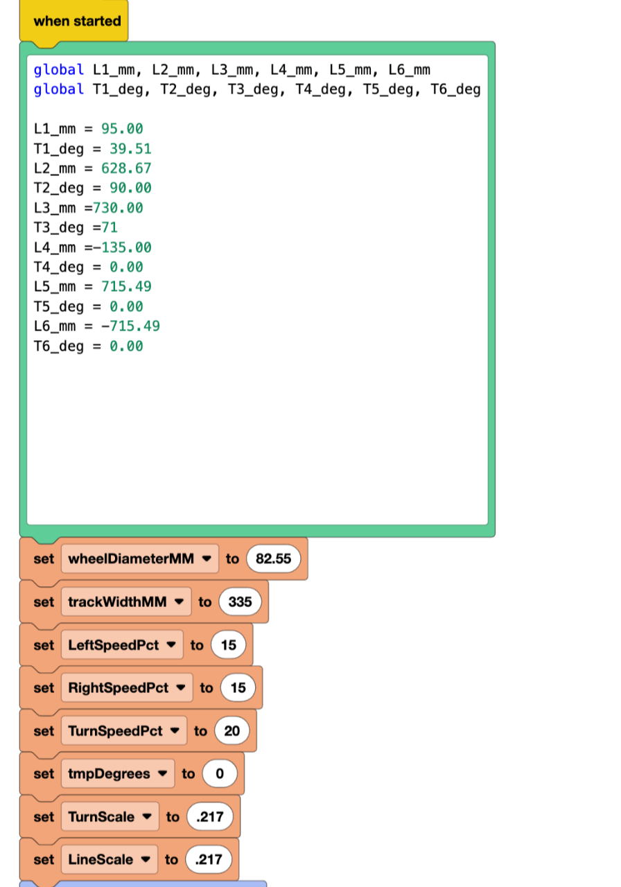
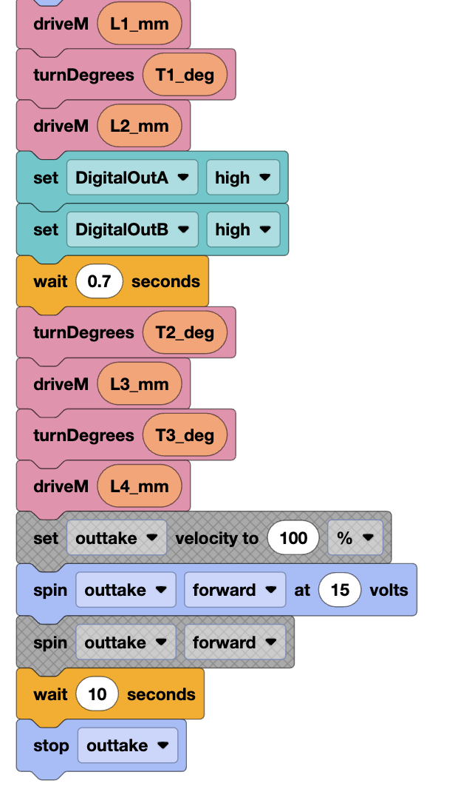
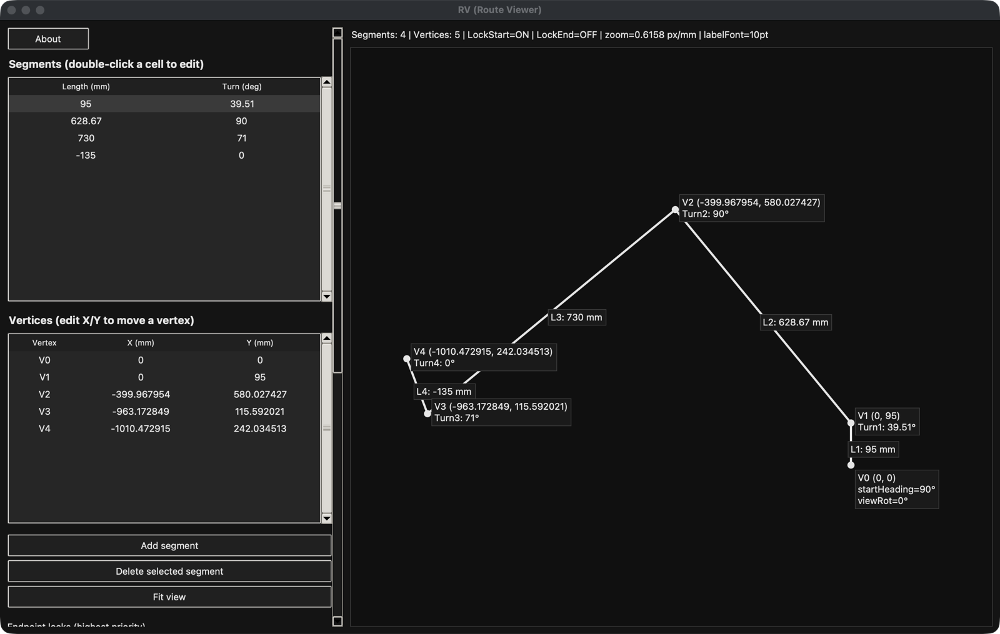

# VEX V5 Autonomous Routines

The autonomous program for our VEX V5 Robotics Competition robot (2025–2026
season), and **RV**, a route visualizer I built to recalibrate that program
quickly between matches.

## The problem

At a tournament there are only a few minutes between matches. When the robot
misses its target, the route has to be fixed fast. Rebuilding Blocks on the spot
is slow and easy to get wrong, and it is hard to picture what changing one turn
does to the rest of the path.

## The solution

**1. The route lives in one text block.** The program keeps every distance and
turn in a single block at the top, so a recalibration means editing numbers,
not blocks:

```python
L1_mm = 95.00
T1_deg = 39.51
L2_mm = 628.67
T2_deg = 90.00
...
```

The routine then runs: drive `L1`, turn `T1`, drive `L2`, turn `T2`, and so on.
A negative length drives backward.

<table>
  <tr>
    <td></td>
    <td></td>
  </tr>
  <tr>
    <td>The route values and robot settings</td>
    <td>The routine that drives through them</td>
  </tr>
</table>

**2. RV shows the route and recalculates it.** RV draws those segments as a
path. When I change one length or turn, it updates every point after it, and
it can keep the start or final position fixed while I adjust the middle. When
the path looks right, **Export Length/Turn** writes the numbers in the exact
format above, ready to paste back into the program.



*The route currently in the program, drawn by RV. The tables on the left are
editable; the path on the right updates as you type.*

## What's in this repo

| Folder | Contents |
|---|---|
| [`autonomous-blocks/`](autonomous-blocks/) | `Autonomous.v5blocks`, the VEXcode V5 program |
| [`route-visualizer/`](route-visualizer/) | `RV.py`, the route visualizer (Python, no installs needed) |
| [`docs/`](docs/) | The team engineering notebook and the autonomous design summary |

## How the autonomous evolved

| When | Change | Skills auton |
|---|---|---|
| Oct 2025 | Started on a drive-base-only prototype; distance-based moves | — |
| Nov 22 (first competition) | Heading drift and inconsistent intake | 2 AP / 26 pts |
| Dec 10 | Rewritten for a new gear ratio and intake timing | 0 AP / 26 pts |
| Late Dec – early Jan | Switched from distance-based to time-based control | 26 AP / 65 pts |
| By Jan 24, 2026 | Separate left-side and right-side routines | 28 AP / 55 pts |

The biggest remaining error came from placing the preload by hand, which led to
the next step: sensor-based control. The full write-up is in
[`docs/autonomous-design-summary-2026-01-25.pdf`](docs/autonomous-design-summary-2026-01-25.pdf).

## Author

Vania Dutta, team programmer (autonomous, sensors, Blocks).
RV was developed with the help of ChatGPT.
