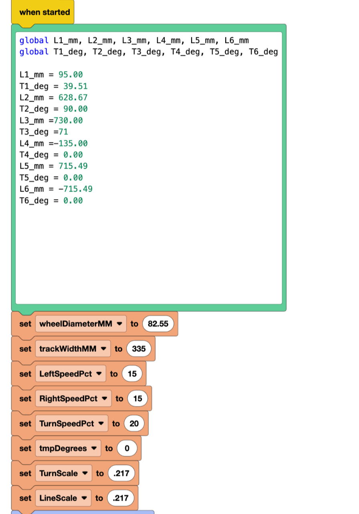
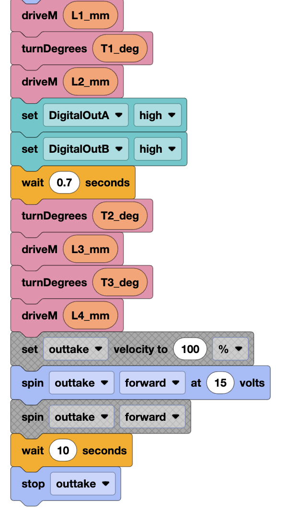

# Autonomous block code

`Autonomous.v5blocks` is the program the robot runs during the autonomous period.

## Opening it

1. Go to <https://codev5.vex.com/>, or open the VEXcode V5 app.
2. Choose **File → Open** and pick `Autonomous.v5blocks`.

<table>
  <tr>
    <td></td>
    <td></td>
  </tr>
  <tr>
    <td>The route values and robot settings</td>
    <td>The routine that drives through them</td>
  </tr>
</table>

## How the program is organised

- **Route values.** A text block at the top sets `L1_mm`–`L6_mm` (distance of each
  move, in millimetres) and `T1_deg`–`T6_deg` (turn after each move, in degrees).
  This is the only part that changes when recalibrating.
- **Robot settings.** Wheel diameter, track width, drive and turn speeds, and the
  two scale factors (`LineScale`, `TurnScale`) that convert millimetres and
  degrees into motor rotation. The scale factors were tuned on the field.
- **Two custom blocks.** `driveM` drives a distance and `turnDegrees` turns in
  place. Both are built from the drive motors' encoders.
- **The routine.** It drives and turns through the route values, raises the
  match loader with the pneumatics partway through, and runs the outtake at
  the end. (The greyed-out blocks are disabled.)

## Recalibrating at a tournament

Edit the numbers in the text block, or design the route in the
[Route Visualizer](../route-visualizer/) and paste its exported text over the
block's contents.

The program has slots for six moves. A route with more than six needs more
`L`/`T` variables and more `driveM`/`turnDegrees` blocks.

## Robot configuration

| Port | Device |
|---|---|
| 1–3 | Left drive motors (`L1`–`L3`) |
| 4–6 | Right drive motors (`R1`–`R3`, reversed) |
| 7 | Intake |
| 8 | Outtake |
