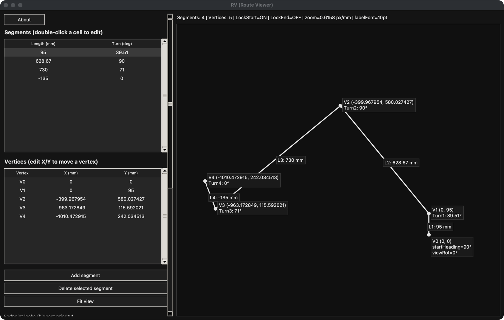

# RV: Route Visualizer

RV draws an autonomous route as a path and recalculates it as you edit, then
exports the lengths and turns in the format the
[block program](../autonomous-blocks/) reads.



## Running it

It needs Python 3 and nothing else (it only uses the built-in `tkinter`).

```
python RV.py
```

On Windows you can download `RV.exe` from this repository's **Releases** page
instead. It runs without Python installed.

## Using it

A route is a list of **segments**. Each one is a length in mm and the turn in
degrees made *after* driving it.

1. **Edit the route.** Double-click a cell in the *Segments* table to change a
   length or turn, or a cell in the *Vertices* table to move a point to exact
   X/Y coordinates. Use **Add segment** / **Delete selected segment** to change
   the number of moves.
2. **Keep what must not move.** *Endpoint locks* hold the start point and/or
   the final point in place. With the final point locked, RV adjusts the
   following segment so the route still ends at the same spot.
3. **Choose what a length edit moves.** Moving the END vertex keeps the start
   fixed; moving the START vertex keeps the end fixed.
4. **Look at it the way the robot sees it.** *View rotation* turns the drawing
   (0°, 90°, 180°, 270°) without changing the route. Scroll to zoom and drag
   with the right mouse button to pan.
5. **Save or send it.** **Save JSON** / **Load JSON** store a route for later.
   **Export Length/Turn** writes a `.txt` file like this:

   ```python
   global L1_mm, L2_mm, L3_mm
   global T1_deg, T2_deg, T3_deg

   L1_mm = 300.00
   T1_deg = 45.00
   ...
   ```

   Paste it into the text block of the block program.

## Building the .exe yourself (Windows)

Double-click `build_exe.bat`. It creates a virtual environment, installs
PyInstaller and writes `dist\RV.exe`.
